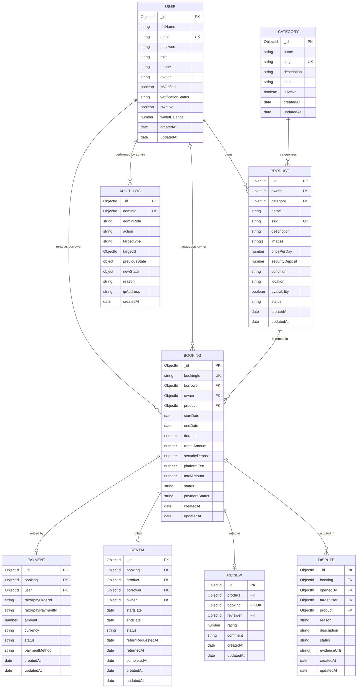

# RENTABLE — Database Architecture & Schema Reference
**Comprehensive MongoDB / Mongoose Data Layer Documentation**

---

## 1. Executive Summary & Data Architecture

RENTABLE uses **MongoDB** as its primary persistent document datastore, accessed and managed through the **Mongoose ODM (Object Data Modeling)** library within a modular **NestJS** backend framework.

Unlike traditional SQL databases that rely on rigid tabular schemas and foreign-key constraints enforced at the database engine level, RENTABLE utilizes:
1. **Document-Oriented Persistence:** Entities are stored as flexible BSON documents grouped into canonical collections.
2. **Schema-Level Validation & Integrity:** Mongoose schemas enforce data types, required fields, enumerations, default values, and index-backed unique constraints before persisting writes to the MongoDB cluster.
3. **Normalized Document References:** Relational links between entities (e.g., a Booking referencing a Borrower, an Owner, and a Product) are maintained via canonical BSON `ObjectId` references (`type: MongooseSchema.Types.ObjectId, ref: '<Model>'`).
4. **Selective Query Population:** Related documents are dynamically populated in service layers (e.g., `.populate('product', 'name images pricePerDay')`) to maintain low storage duplication while providing comprehensive API responses.

---

## 2. Entity-Relationship Overview

The core domain model revolves around **Users**, physical **Products** categorized by **Categories**, and the rental transaction pipeline: **Bookings** $\rightarrow$ **Payments** $\rightarrow$ **Rentals**, flanked by secondary trust-and-safety entities (**Reviews**, **Disputes**, **AuditLogs**, **SecurityDeposits**).



---

## 3. Comprehensive Collection Dictionary

### 3.1 Collection: `users`
- **Mongoose Model:** `User` ([user.schema.ts](file:///home/devprasath/Deva/KRCE/Sem_V/NoSQL/Project/Rentable/backend/src/users/schemas/user.schema.ts))
- **Purpose:** Stores registered account credentials, identity information, role assignments, verification flags, and account status.
- **Timestamps:** Automatic (`createdAt`, `updatedAt`).

| Field Name | BSON / Mongoose Type | Required | Constraints / Defaults | Description |
|---|---|---|---|---|
| `_id` | `ObjectId` | Auto | Unique Primary Key | Canonical user identifier. |
| `fullName` | `String` | Yes | None | Full legal or display name of the user. |
| `email` | `String` | Yes | `unique: true`, trimmed, lowercase | Primary login email address. |
| `password` | `String` | Yes | `select: false` (excluded from queries by default) | Bcrypt salted hash (10 salt rounds). |
| `phone` | `String` | No | Optional | Contact phone number. |
| `role` | `String` | Yes | Enum: `'borrower'`, `'owner'`, `'admin'`, `'super_admin'`, `'operations_admin'`, `'finance_admin'`, `'support_admin'`, `'content_moderator'`. Default: `'borrower'`. | System authorization role. |
| `avatar` | `String` | No | Cloudinary / HTTP image URL | Profile photo location. |
| `isVerified` | `Boolean` | No | Default: `false` | Email or identity verification flag. |
| `verificationStatus`| `String` | No | Enum: `'PENDING'`, `'UNDER_REVIEW'`, `'VERIFIED'`, `'REJECTED'`, `'MORE_INFO_REQUIRED'`. Default: `'PENDING'`. | Identity verification state. |
| `isActive` | `Boolean` | No | Default: `true` | Controls account suspension status. |
| `suspensionReason`| `String` | No | Optional | Explanation recorded when an admin suspends an account. |
| `permissions` | `[String]` | No | Default: `[]` | Granular capability overrides. |
| `walletBalance` | `Number` | No | Default: `0` | Available internal wallet credit in INR. |

---

### 3.2 Collection: `products`
- **Mongoose Model:** `Product` ([product.schema.ts](file:///home/devprasath/Deva/KRCE/Sem_V/NoSQL/Project/Rentable/backend/src/products/schemas/product.schema.ts))
- **Purpose:** Represents equipment, cameras, vehicles, and tools available for rental.
- **Timestamps:** Automatic (`createdAt`, `updatedAt`).

| Field Name | BSON / Mongoose Type | Required | Constraints / Defaults | Description |
|---|---|---|---|---|
| `_id` | `ObjectId` | Auto | Unique Primary Key | Canonical product identifier. |
| `owner` | `ObjectId` | Yes | Ref: `User` | Account ID of the product owner. |
| `name` | `String` | Yes | None | Product title (e.g., "Sony Alpha 7 IV"). |
| `slug` | `String` | Yes | `unique: true` | URL-safe slug generated from name. |
| `description` | `String` | Yes | Full text | Detailed specification and usage guidelines. |
| `category` | `ObjectId` | Yes | Ref: `Category` | Category taxonomy classification. |
| `images` | `[String]` | No | Default: `[]` | Array of Cloudinary media asset URLs. |
| `pricePerDay` | `Number` | Yes | Minimum $\ge 0$ | Daily base rental rate in INR (Rupees). |
| `securityDeposit`| `Number` | Yes | Minimum $\ge 0$ | Refundable security deposit held in trust. |
| `condition` | `String` | Yes | E.g., `'New'`, `'Like New'`, `'Good'`, `'Fair'` | Physical condition report. |
| `location` | `String` | Yes | None | City / Pickup location of the equipment. |
| `availability` | `Boolean` | No | Default: `true` | Master owner availability toggle. |
| `rentalRules` | `String` | No | Optional | Owner-imposed rules (e.g., "Indoor use only"). |
| `cancellationPolicy` | `String` | No | Optional | Cancellation & refund parameters. |
| `status` | `String` | No | Enum: `'DRAFT'`, `'PENDING_APPROVAL'`, `'ACTIVE'`, `'PAUSED'`, `'REJECTED'`, `'REMOVED'`. Default: `'PENDING_APPROVAL'`. | Product lifecycle and moderation status. |

---

### 3.3 Collection: `categories`
- **Mongoose Model:** `Category` ([category.schema.ts](file:///home/devprasath/Deva/KRCE/Sem_V/NoSQL/Project/Rentable/backend/src/categories/schemas/category.schema.ts))
- **Purpose:** Marketplace taxonomy organizing items into logical domains (Cameras, Electronics, Mobility, Outdoor Gear).
- **Timestamps:** Automatic (`createdAt`, `updatedAt`).

| Field Name | BSON / Mongoose Type | Required | Constraints / Defaults | Description |
|---|---|---|---|---|
| `_id` | `ObjectId` | Auto | Unique Primary Key | Category identifier. |
| `name` | `String` | Yes | None | Category display name (e.g. "Photography"). |
| `slug` | `String` | Yes | `unique: true` | URL slug (e.g., `"cameras"`). |
| `description` | `String` | No | Optional | Category overview text. |
| `icon` | `String` | No | Optional | Icon glyph identifier. |
| `isActive` | `Boolean` | No | Default: `true` | Category visibility toggle. |

---

### 3.4 Collection: `bookings`
- **Mongoose Model:** `Booking` ([booking.schema.ts](file:///home/devprasath/Deva/KRCE/Sem_V/NoSQL/Project/Rentable/backend/src/bookings/schemas/booking.schema.ts))
- **Purpose:** Core rental agreement linking a borrower, an owner, and a product for a specific calendar window with itemized pricing.
- **Timestamps:** Automatic (`createdAt`, `updatedAt`).

| Field Name | BSON / Mongoose Type | Required | Constraints / Defaults | Description |
|---|---|---|---|---|
| `_id` | `ObjectId` | Auto | Unique Primary Key | Canonical booking identifier. |
| `bookingId` | `String` | No | `unique: true` (Auto-generated) | Human-readable reference code (e.g., `BKG-941831-337`). |
| `borrower` | `ObjectId` | Yes | Ref: `User` | User requesting the rental. |
| `owner` | `ObjectId` | Yes | Ref: `User` | User who owns the rented asset. |
| `product` | `ObjectId` | Yes | Ref: `Product` | The item being rented. |
| `startDate` | `Date` | Yes | ISO 8601 Date | Rental start / pickup date. |
| `endDate` | `Date` | Yes | ISO 8601 Date | Rental return date. |
| `duration` | `Number` | Yes | Calculated: $\lceil (end - start) \rceil$ | Duration in calendar days (min 1). |
| `rentalAmount` | `Number` | Yes | $pricePerDay \times duration$ | Base equipment rental cost in INR. |
| `securityDeposit`| `Number` | Yes | Product snapshot | Held deposit amount in INR. |
| `platformFee` | `Number` | Yes | $10\%$ of rentalAmount | RENTABLE marketplace commission in INR. |
| `totalAmount` | `Number` | Yes | $rentalAmount + securityDeposit + platformFee$ | Full amount payable by borrower. |
| `status` | `String` | No | Enum: `'PENDING'`, `'CONFIRMED'`, `'REJECTED'`, `'CANCELLED'`, `'ACTIVE'`, `'COMPLETED'`, `'RETURNED'`. Default: `'PENDING'`. | Rental lifecycle state. |
| `paymentStatus` | `String` | No | Enum: `'PENDING'`, `'PAID'`, `'FAILED'`, `'REFUNDED'`. Default: `'PENDING'`. | Financial settlement state. |

---

### 3.5 Collection: `payments`
- **Mongoose Model:** `Payment` ([payment.schema.ts](file:///home/devprasath/Deva/KRCE/Sem_V/NoSQL/Project/Rentable/backend/src/payments/schemas/payment.schema.ts))
- **Purpose:** Immutable audit record of checkout transactions, Razorpay order IDs, and payment simulation events.
- **Timestamps:** Automatic (`createdAt`, `updatedAt`).

| Field Name | BSON / Mongoose Type | Required | Constraints / Defaults | Description |
|---|---|---|---|---|
| `_id` | `ObjectId` | Auto | Unique Primary Key | Canonical payment ledger ID. |
| `booking` | `ObjectId` | Yes | Ref: `Booking` | The associated rental booking. |
| `user` | `ObjectId` | Yes | Ref: `User` | The payer (Borrower). |
| `razorpayOrderId` | `String` | Yes | Gateway order reference | Order ID from Razorpay or simulation (`order_sim_...`). |
| `razorpayPaymentId`| `String` | No | Gateway payment reference | Captured payment ID (`pay_sim_...`). |
| `amount` | `Number` | Yes | Smallest currency unit (Paise) | Total payment in **Paise** ($₹100 = 10,000$ paise). |
| `currency` | `String` | No | Default: `'INR'` | Currency code. |
| `status` | `String` | No | Enum: `'CREATED'`, `'PENDING'`, `'SUCCESS'`, `'FAILED'`, `'REFUNDED'`. Default: `'CREATED'`. | Gateway transaction state. |
| `paymentMethod` | `String` | No | Enum: `'RAZORPAY'`. Default: `'RAZORPAY'`. | Payment processor. |

---

### 3.6 Collection: `rentals`
- **Mongoose Model:** `Rental` ([rental.schema.ts](file:///home/devprasath/Deva/KRCE/Sem_V/NoSQL/Project/Rentable/backend/src/rentals/schemas/rental.schema.ts))
- **Purpose:** Active physical possession tracking once a booking has been confirmed and paid.
- **Timestamps:** Automatic (`createdAt`, `updatedAt`).

| Field Name | BSON / Mongoose Type | Required | Constraints / Defaults | Description |
|---|---|---|---|---|
| `_id` | `ObjectId` | Auto | Unique Primary Key | Rental fulfillment record ID. |
| `booking` | `ObjectId` | Yes | Ref: `Booking` | Associated parent booking. |
| `product` | `ObjectId` | Yes | Ref: `Product` | Asset in borrower custody. |
| `borrower` | `ObjectId` | Yes | Ref: `User` | Custodian borrower. |
| `owner` | `ObjectId` | Yes | Ref: `User` | Equipment owner. |
| `startDate` | `Date` | Yes | Rental start date | Scheduled possession date. |
| `endDate` | `Date` | Yes | Scheduled return date | Due return date. |
| `status` | `String` | No | Enum: `'UPCOMING'`, `'ACTIVE'`, `'RETURN_REQUESTED'`, `'RETURNED'`, `'COMPLETED'`. Default: `'UPCOMING'`. | Physical custody status. |
| `returnRequestedAt` | `Date` | No | Optional | Timestamp when borrower requested return inspection. |
| `returnedAt` | `Date` | No | Optional | Timestamp when gear was returned. |
| `completedAt` | `Date` | No | Optional | Timestamp when owner approved return inspection. |

---

### 3.7 Collection: `reviews`
- **Mongoose Model:** `Review` ([review.schema.ts](file:///home/devprasath/Deva/KRCE/Sem_V/NoSQL/Project/Rentable/backend/src/reviews/schemas/review.schema.ts))
- **Purpose:** Authenticated borrower feedback on rented items.
- **Timestamps:** Automatic (`createdAt`, `updatedAt`).

| Field Name | BSON / Mongoose Type | Required | Constraints / Defaults | Description |
|---|---|---|---|---|
| `_id` | `ObjectId` | Auto | Unique Primary Key | Review record ID. |
| `product` | `ObjectId` | Yes | Ref: `Product` | The reviewed product. |
| `booking` | `ObjectId` | Yes | Ref: `Booking`, `unique: true` | Guarantees only one review per verified booking. |
| `reviewer` | `ObjectId` | Yes | Ref: `User` | Borrower who authored the review. |
| `rating` | `Number` | Yes | Minimum: `1`, Maximum: `5` | Star rating integer. |
| `comment` | `String` | Yes | Text | Written evaluation of gear performance and owner communication. |

---

### 3.8 Collection: `disputes`
- **Mongoose Model:** `Dispute` ([dispute.schema.ts](file:///home/devprasath/Deva/KRCE/Sem_V/NoSQL/Project/Rentable/backend/src/disputes/schemas/dispute.schema.ts))
- **Purpose:** Formal mediation claims opened by either borrower or owner regarding damages, missing accessories, or deposit holds.
- **Timestamps:** Automatic (`createdAt`, `updatedAt`).

| Field Name | BSON / Mongoose Type | Required | Constraints / Defaults | Description |
|---|---|---|---|---|
| `_id` | `ObjectId` | Auto | Unique Primary Key | Dispute case ID. |
| `booking` | `ObjectId` | Yes | Ref: `Booking` | Disputed rental transaction. |
| `openedBy` | `ObjectId` | Yes | Ref: `User` | Party initiating the claim. |
| `targetUser` | `ObjectId` | Yes | Ref: `User` | Counterparty. |
| `product` | `ObjectId` | Yes | Ref: `Product` | Item subject to claim. |
| `reason` | `String` | Yes | Category | Reason for dispute. |
| `description` | `String` | Yes | Text | Detailed factual account. |
| `status` | `String` | No | Enum: `'OPENED'`, `'UNDER_REVIEW'`, `'EVIDENCE_REQUESTED'`, `'MEDIATION'`, `'RESOLVED'`, `'ESCALATED'`, `'CLOSED'`. Default: `'OPENED'`. | Mediation progression status. |
| `evidenceUrls` | `[String]` | No | Default: `[]` | URLs of photographic condition evidence. |
| `assignedAdmin`| `ObjectId` | No | Ref: `User` | Marketplace officer handling case. |
| `resolution` | `Object` | No | Embedded Subdocument | Outcome `{ action, amount, reason, resolvedAt, resolvedBy }`. |

---

### 3.9 Collection: `auditlogs`
- **Mongoose Model:** `AuditLog` ([audit-log.schema.ts](file:///home/devprasath/Deva/KRCE/Sem_V/NoSQL/Project/Rentable/backend/src/audit/schemas/audit-log.schema.ts))
- **Purpose:** Immutable compliance and governance trail recording administrative actions.
- **Timestamps:** Automatic (`createdAt`, `updatedAt`).

| Field Name | BSON / Mongoose Type | Required | Constraints / Defaults | Description |
|---|---|---|---|---|
| `_id` | `ObjectId` | Auto | Unique Primary Key | Audit entry identifier. |
| `adminId` | `ObjectId` | Yes | Ref: `User` | Administrator who triggered action. |
| `adminRole` | `String` | Yes | E.g. `'admin'`, `'super_admin'` | Role of acting officer. |
| `action` | `String` | Yes | E.g. `'USER_SUSPENDED'`, `'PRODUCT_DELETED'` | Standardized action verb. |
| `targetType` | `String` | Yes | E.g. `'User'`, `'Product'`, `'Category'` | Target entity type. |
| `targetId` | `ObjectId` | Yes | Target document ID | Target entity ID. |
| `previousState`| `Object` | No | JSON snapshot | Pre-mutation entity snapshot. |
| `newState` | `Object` | No | JSON snapshot | Post-mutation entity snapshot. |
| `reason` | `String` | No | Optional | Documented administrative rationale. |
| `ipAddress` | `String` | No | Optional | Originating IP address. |

---

## 4. Referential Integrity & MongoDB Index Strategy

### 4.1 Index Definitions
To maintain sub-millisecond query performance and ensure business invariants, MongoDB indexes are registered across critical fields:

```typescript
// users collection
users.createIndex({ email: 1 }, { unique: true });

// products collection
products.createIndex({ slug: 1 }, { unique: true });
products.createIndex({ owner: 1, status: 1 });
products.createIndex({ category: 1, availability: 1 });

// bookings collection
bookings.createIndex({ bookingId: 1 }, { unique: true, sparse: true });
bookings.createIndex({ product: 1, startDate: 1, endDate: 1, status: 1 });
bookings.createIndex({ borrower: 1, createdAt: -1 });
bookings.createIndex({ owner: 1, paymentStatus: 1 });

// reviews collection
reviews.createIndex({ booking: 1 }, { unique: true });
reviews.createIndex({ product: 1, rating: -1 });

// payments collection
payments.createIndex({ booking: 1 });
payments.createIndex({ razorpayOrderId: 1 });
```

### 4.2 Overlapping Date Conflict Detection
Data integrity during booking creation is guaranteed via explicit date overlap checks in `BookingsService.checkAvailability()`:

$$\text{Overlap Condition: } (\text{Existing.startDate} \le \text{Requested.endDate}) \land (\text{Existing.endDate} \ge \text{Requested.startDate})$$

Any existing booking with `status \notin ['CANCELLED', 'REJECTED']` satisfying this condition causes the backend to immediately reject the request with HTTP `400 Bad Request: "Product is already booked for the selected dates"`.
