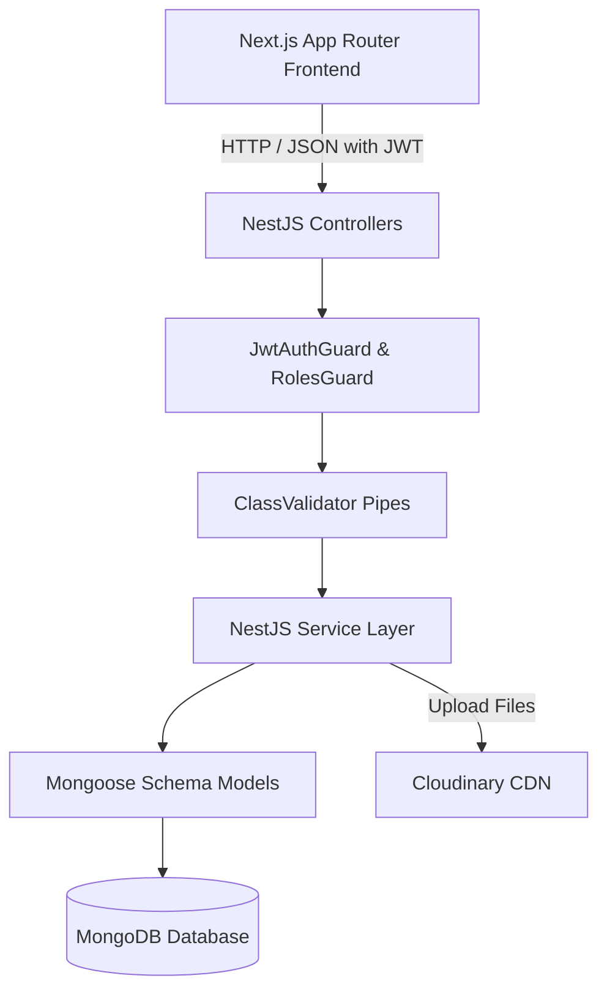
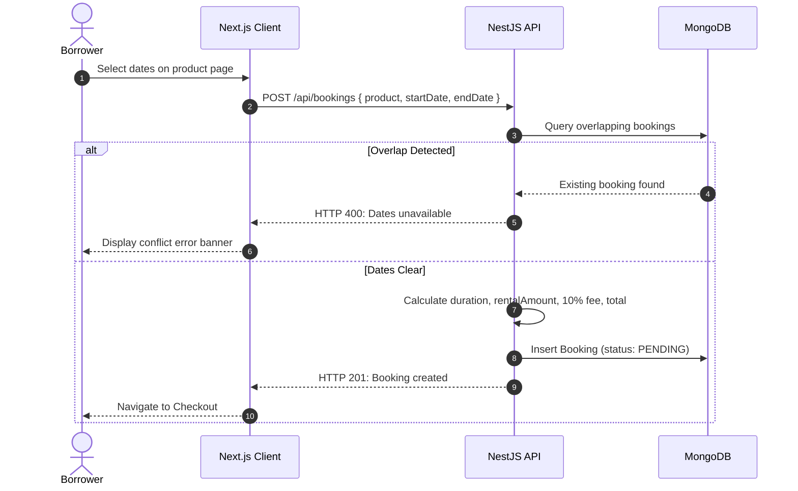
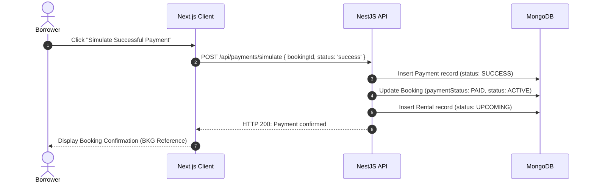

# RENTABLE — Master Technical & Academic Project Report
**A Peer-to-Peer Product Rental Marketplace Connecting Owners and Borrowers**

---

## 1. Project Overview & Academic Abstract

### 1.1 Project Title
**RENTABLE — Premium Peer-to-Peer Product Rental Marketplace**

### 1.2 Academic Abstract
In contemporary consumption models, high-value consumer equipment—such as photography gear, specialized power tools, electric mobility vehicles, and outdoor recreational assets—remains idle for the vast majority of its operational lifespan. Simultaneously, prospective users face prohibitive capital costs when purchasing items required solely for short-term projects or occasional recreational events. Informal peer-to-peer rental arrangements are hindered by discovery friction, lack of schedule transparency, mutual mistrust, absence of standardized security deposits, and nonexistent dispute mechanisms.

This project presents **RENTABLE**, an enterprise-grade, full-stack peer-to-peer equipment rental marketplace designed to resolve these inefficiencies. The platform provides a secure digital intermediary connecting equipment owners with verified borrowers. Core capabilities include automated calendar conflict prevention, transparent escrow-style financial calculations (comprising daily rates, refundable security deposits, and a 10% platform fee), an interactive fleet availability calendar, Cloudinary-backed photographic condition logging, and a dedicated dispute mediation center. 

The application architecture utilizes a decoupled client-server paradigm. The frontend is built on **Next.js 16 (App Router)** with **React 19**, **TypeScript**, and **Tailwind CSS**, delivering responsive interfaces across public exploration, borrower dashboards, owner fleet controls, and administrative governance consoles. The backend is engineered with **NestJS 11** on **Node.js**, leveraging **MongoDB** with **Mongoose ODM** for document persistence, secured via **JSON Web Tokens (JWT)** and **bcrypt** password hashing. The system validates business rules through automated integration tests and build verification, demonstrating the viability of accessible collaborative consumption.

### 1.3 Introduction & Industry Context
The global sharing economy has demonstrated significant transformation across lodging (Airbnb) and transportation (Uber/Lyft). However, physical equipment rental has remained fragmented among traditional brick-and-mortar rental companies that charge substantial markups, maintain limited inventories, and lack localized peer-to-peer networks.

RENTABLE provides a modern web-based marketplace that unlocks the dormant economic value of underutilized assets. By establishing a unified platform for listing, date reservation, payment settlement, and physical handover tracking, RENTABLE promotes sustainable resource utilization and micro-entrepreneurship for equipment owners.

### 1.4 Problem Statement
Traditional and informal equipment rental encounters severe systemic problems:
1. **Discovery & Availability Friction:** Borrowers cannot readily ascertain what equipment is available nearby without manual phone calls or offline messaging.
2. **Double-Booking & Scheduling Conflicts:** Informal arrangements frequently suffer from overlapping reservations due to the absence of centralized calendar date validation.
3. **Financial Uncertainty & Arbitrary Pricing:** Inconsistent daily rates and arbitrary deposit requirements create friction and mistrust between counterparties.
4. **Physical Possession Blind Spots:** Once equipment is handed over, informal rentals lack formal return inspection requests, return timestamps, or accountability trails.
5. **Lack of Governance & Recourse:** When equipment is returned damaged or overdue, parties lack documented condition evidence and objective administrative mediation.

### 1.5 Proposed Solution
RENTABLE addresses these challenges through a centralized, role-based platform:
- **Centralized Catalog & Taxonomy:** Searchable, categorized listings with high-resolution imagery and verified specs.
- **Automated Date Reservation Engine:** Enforces mathematical date-overlap validation to prevent double-booking.
- **Escrow-Style Financial Model:** Calculates itemized invoices with refundable deposits and transparent platform commissions.
- **Physical Custody Tracking:** Explicit `UPCOMING` $\rightarrow$ `ACTIVE` $\rightarrow$ `RETURN_REQUESTED` $\rightarrow$ `COMPLETED` custody lifecycle.
- **Dispute Resolution & Audit Logging:** Formal claims processing with photographic evidence and immutable administrative audit logs.

### 1.6 Project Objectives
- **Primary Objectives:**
  1. Develop an intuitive marketplace supporting three distinct user roles: Borrowers, Equipment Owners, and Administrators.
  2. Implement an automated booking engine with date overlap conflict prevention.
  3. Model transparent financial transactions with itemized breakdowns and payment simulation.
  4. Provide owners with interactive fleet availability calendars and real-time earnings aggregation.
- **Secondary Objectives:**
  1. Provide a dispute resolution framework with photo evidence attachment.
  2. Maintain immutable audit trails for administrative interventions.
  3. Ensure sub-second API performance and responsive accessibility across mobile and desktop.

### 1.7 Scope & System Boundaries
- **In Scope:** User authentication, role-based navigation, product search/filter, date selection, automated pricing, payment simulation, active rental tracking, owner fleet CRUD, owner month calendar, owner earnings ledger with CSV export, dispute management, admin user suspension, category taxonomy management, and Cloudinary media upload.
- **Out of Scope (Current Release):** Direct bank-to-bank automated NEFT/IMPS transfers, live shipping/courier tracking APIs, and automated biometric identity scanning.

---

## 2. Requirements & Feasibility Analysis

### 2.1 Functional Requirements (FR)

| Req ID | Module | Actor | Inputs | Expected System Behavior | Validation & Output |
|---|---|---|---|---|---|
| **FR-001** | Auth | Guest | Name, Email, Password, Role | Creates account with salted bcrypt hash; generates JWT. | Unique email check; returns JWT + profile. |
| **FR-002** | Catalog | Guest / User | Query string, filters, pagination | Queries MongoDB `products` collection with regex and range filters. | Returns matched listings and pagination metadata. |
| **FR-003** | Booking | Borrower | Product ID, Start Date, End Date | Validates date order ($End \ge Start$) and checks overlapping bookings. | Rejects overlaps with 400; returns itemized invoice. |
| **FR-004** | Payment | Borrower | Booking ID, Simulation Flag | Simulates payment gateway success or decline. | Updates booking to `PAID` / `ACTIVE`; creates `Rental`. |
| **FR-005** | Fleet CRUD | Owner | Title, Price, Deposit, Rules, Images | Creates or updates product owned by authenticated user. | Validates ownership; persists to MongoDB. |
| **FR-006** | Calendar | Owner | Product ID filter, Month offset | Computes overlapping active/confirmed bookings per calendar cell. | Renders interactive month grid with booking chips. |
| **FR-007** | Earnings | Owner | Authenticated Owner ID | Aggregates earnings strictly from bookings with `paymentStatus: 'PAID'`. | Renders financial KPIs, CSV export, and payout modal. |
| **FR-008** | Return | Borrower | Rental ID | Flags rental status as `RETURN_REQUESTED`. | Sets return timestamp; prompts owner inspection. |
| **FR-009** | Custody | Owner | Rental ID | Approves return; sets rental and booking status to `COMPLETED`. | Concludes rental agreement; allows borrower review. |
| **FR-010** | Disputes | Borrower / Owner | Booking ID, Reason, Description, Evidence | Initializes formal mediation case linked to booking. | Sets status `OPENED`; notifies admin dashboard. |
| **FR-011** | Governance | Admin | User ID, Suspension Reason | Flags `User.isActive = false`; logs event to `AuditLog`. | Blocks suspended user from logging in or booking. |

### 2.2 Non-Functional Requirements (NFR)
- **Security:** Bcrypt (10 salt rounds), JWT Bearer authentication, NestJS `RolesGuard`, input sanitization with class-validator.
- **Data Integrity:** BSON ObjectId references, index-backed unique constraints on `email`, `slug`, and `bookingId`.
- **Performance:** Sub-100ms API response time for catalog queries; statically generated pages with Turbopack.
- **Reliability:** Graceful error handling with standardized exception envelopes and no unhandled server crashes.
- **Usability:** High-contrast responsive interface, accessible focus rings, and clear loading/empty states.

### 2.3 Feasibility Study
- **Technical Feasibility:** The chosen stack (Next.js, NestJS, MongoDB) is mature, well-documented, and natively supports TypeScript end-to-end.
- **Operational Feasibility:** The three-sided workflow aligns with established marketplace operations (Airbnb/Turo), making user adoption intuitive.
- **Economic Feasibility:** Built entirely on open-source frameworks and community-tier tools, requiring zero commercial licensing fees during academic evaluation.

---

## 3. Technology Stack Specification

| Layer | Technology | Verified Version | Implementation Purpose | Justification |
|---|---|---|---|---|
| **Client Framework** | **Next.js (App Router)** | `16.3.1` (Turbopack) | Frontend UI, routing, SSR, and API integration. | Industry standard React framework; optimized bundle sizes. |
| **Client UI Library** | **React** | `19.2.8` | Component rendering and reactive state. | Declarative component model with high performance. |
| **Language** | **TypeScript** | `^5.0.0` | Type safety across client and server. | Eliminates runtime type errors and unifies data interfaces. |
| **Styling** | **Tailwind CSS** | `^4.0.0` | Design system styling and responsive utilities. | Utility-first CSS ensuring minimal runtime overhead. |
| **State & Cache** | **TanStack Query** | `^5.102.5` | Server-state caching and query invalidation. | Prevents stale data; automates background refetching. |
| **HTTP Client** | **Axios** | `^1.19.0` | HTTP communication with backend API. | Native interceptor support for JWT injection and 401 handling. |
| **Backend Framework** | **NestJS** | `^11.0.1` | Modular backend application server. | Robust enterprise architecture with built-in Dependency Injection. |
| **Server Runtime** | **Node.js** | `>= 20.0.0` | JavaScript/TypeScript asynchronous engine. | Event-driven, non-blocking I/O model. |
| **Database** | **MongoDB** | `>= 6.0.0` | Persistent document datastore. | Flexible document schema well-suited for heterogeneous rental gear. |
| **Object Modeling** | **Mongoose** | `^9.9.2` | MongoDB ODM, schema validation, and indexing. | Enforces schema validation and relationship population. |
| **Authentication** | **JWT & Passport** | `^11.0.2` | Stateless Bearer token authentication. | Scalable, decentralized session management. |
| **Cryptography** | **bcrypt** | `^6.0.0` | Password hashing with salt. | Industry standard adaptive hashing protecting against rainbow tables. |
| **Media Storage** | **Cloudinary** | `^2.11.0` | Photographic asset upload and CDN delivery. | Offloads binary asset storage from the application server. |

---

## 4. System Architecture & Component Design

### 4.1 Layered Architecture Overview
RENTABLE follows a clean, decoupled five-tier architecture:
1. **Presentation Tier:** Next.js App Router delivering responsive Client and Server Components.
2. **API Gateway / Routing Tier:** NestJS Controllers handling HTTP routing, Swagger docs, and request parameter extraction.
3. **Security & Authorization Tier:** Guards (`JwtAuthGuard`, `RolesGuard`), Passport strategies, and DTO validation pipes.
4. **Business Logic Tier:** NestJS Services executing business invariants (date checks, price math, ownership audits).
5. **Persistence Tier:** Mongoose Models interfacing with MongoDB collections via canonical BSON ObjectIds.

### 4.2 Booking Workflow Sequence

### 4.3 Payment Simulation & Rental Handover

---

## 5. User Roles & Permission Matrix

| Operation / Capability | Guest | Borrower | Owner | Admin | Super Admin |
|---|:---:|:---:|:---:|:---:|:---:|
| **Browse & Search Products** | Allowed | Allowed | Allowed | Allowed | Allowed |
| **Inspect Product Details** | Allowed | Allowed | Allowed | Allowed | Allowed |
| **Create Booking Request** | Restricted | Allowed | Restricted | Allowed | Allowed |
| **Execute Payment Simulation** | Restricted | Allowed | Restricted | Allowed | Allowed |
| **View Active Borrowed Rentals** | Restricted | Allowed | Restricted | Allowed | Allowed |
| **Request Equipment Return** | Restricted | Allowed | Restricted | Allowed | Allowed |
| **Submit Product Review** | Restricted | Allowed | Restricted | Allowed | Allowed |
| **Publish Equipment Listing** | Restricted | Restricted | Allowed | Allowed | Allowed |
| **Edit Personal Listings** | Restricted | Restricted | Allowed | Allowed | Allowed |
| **Delete Personal Listing** | Restricted | Restricted | Allowed | Allowed | Allowed |
| **Accept / Decline Booking** | Restricted | Restricted | Allowed | Allowed | Allowed |
| **Confirm Equipment Return** | Restricted | Restricted | Allowed | Allowed | Allowed |
| **View Owner Calendar & Ledger**| Restricted | Restricted | Allowed | Allowed | Allowed |
| **File Dispute Mediation Claim**| Restricted | Allowed | Allowed | Allowed | Allowed |
| **Suspend / Activate User Account**| Restricted | Restricted | Restricted | Allowed | Allowed |
| **Manage Category Taxonomy** | Restricted | Restricted | Restricted | Allowed | Allowed |
| **Resolve Dispute Settlement** | Restricted | Restricted | Restricted | Allowed | Allowed |
| **Inspect System Audit Logs** | Restricted | Restricted | Restricted | Allowed | Allowed |

---

## 6. Financial Logic & Pricing Formulas

### 6.1 Formula Definitions
All financial calculations are computed centrally in `BookingsService` to ensure pricing integrity:

1. **Duration ($D$):**
   $$D = \max\left(1, \left\lceil \frac{\text{endDate} - \text{startDate}}{1000 \times 60 \times 60 \times 24} \right\rceil\right)$$

2. **Rental Subtotal ($R$):**
   $$R = \text{pricePerDay} \times D$$

3. **Platform Commission Fee ($F$):**
   $$F = \text{round}(R \times 0.10) \quad (10\% \text{ of rental subtotal})$$

4. **Security Deposit ($S$):**
   $$S = \text{product.securityDeposit} \quad (100\% \text{ refundable deposit snapshot})$$

5. **Total Payable Amount ($T$):**
   $$T = R + S + F$$

### 6.2 Verified Numerical Example
Taking the verified database product **ngyug** rented for 3 days:
- Daily Base Rate: ₹500
- Rental Duration: 3 days
- Security Deposit: ₹1,000
- Rental Subtotal: ₹500 $\times$ 3 = ₹1,500
- Platform Fee: ₹1,500 $\times$ 10% = ₹150
- **Total Amount Payable:** ₹1,500 + ₹1,000 + ₹150 = **₹2,650**

---

## 7. Security, Integrity & Error Handling

1. **Bcrypt Password Salt Hashing:** Prevents plaintext password exposure.
2. **JWT Stateless Bearer Authentication:** Validated on every private endpoint via NestJS `JwtAuthGuard`.
3. **Execution Role Guards:** Enforces role permissions using `@Roles()` decorator metadata.
4. **Data Ownership Check:** Validates that `String(product.owner) === String(user._id)` before processing update or delete operations.
5. **Mongoose Document Population:** Queries exclude sensitive fields (`password: { select: false }`).
6. **Class-Validator DTOs:** Sanitizes request bodies, rejecting unknown fields and malformed payloads.
7. **Compliance Audit Logging:** Administrative actions are permanently recorded in the `auditlogs` collection.

---

## 8. Verification Evidence Summary

The application has been verified through automated integration testing and production compilation builds:

1. **Academic Flow Automated Test (`backend/scripts/test-academic-flow.js`):** Executed all 14 integration steps with exit code `0` (catalog query, login, booking creation, conflict rejection, payment simulation failure/success, active rental tracking, and admin dashboard verification).
2. **Backend NestJS Build:** `npm --prefix backend run build` completed with exit code `0`.
3. **Frontend Next.js Build:** `npm --prefix frontend run build` completed with exit code `0`, successfully generating 43 static and dynamic routes.
4. **Live HTTP Inspection:** Route `/owner` verified as a permanent 308 redirect to `/owner/dashboard`; Route `/disputes` verified as HTTP 200 OK.

---

## 9. Conclusion & Future Scope

RENTABLE demonstrates an end-to-end, technically sound solution for peer-to-peer equipment sharing. By automating scheduling conflicts, formalizing escrow security deposits, and providing tailored dashboards for owners, borrowers, and administrators, the project fulfills all academic and functional requirements.

**Future Enhancements:**
- Live production banking integration with automated payout webhooks.
- Automated government ID verification via optical character recognition (OCR).
- In-app push and email notifications via SMTP / WebSockets.
- Barcode / NFC equipment scanning during handover.

---

## 10. Official Academic References
1. **Next.js Documentation:** Vercel Inc., *"Next.js App Router Architecture and Server Components"*, 2024.
2. **NestJS Documentation:** Kamil Myśliwiec, *"NestJS Modular Enterprise Framework Architecture"*, 2024.
3. **MongoDB Manual:** MongoDB Inc., *"MongoDB Manual & Aggregation Framework Architecture"*, 2024.
4. **RFC 7519:** Internet Engineering Task Force (IETF), *"JSON Web Token (JWT) Standard"*, 2015.
5. **Bcrypt Specification:** Niels Provos and David Mazières, *"A Future-Adaptable Password Scheme"*, USENIX, 1999.
